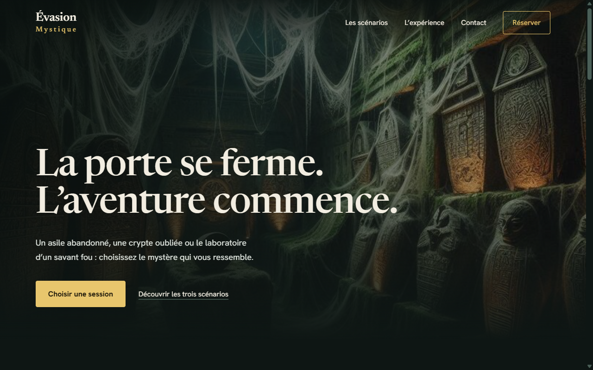

# Évasion Mystique

Vitrine d’escape game et espace de gestion local. Les visiteurs choisissent une session et envoient une demande ; l’équipe peut gérer les scénarios, sessions, réservations et comptes de démonstration.

Ce projet est une démonstration open source sous [Apache 2.0](LICENSE). L’API json-server n’offre ni authentification serveur ni verrouillage des réservations concurrentes. Elle doit rester locale.



Captures pleine page : [desktop](docs/vitrine-desktop.png) · [mobile](docs/vitrine-mobile.png).

**Démo en ligne**, version statique sans serveur :
- Vitrine : https://mazounirayan.github.io/escape-game-site/
- Espace de gestion : https://mazounirayan.github.io/escape-game-site/admin/ (compte fictif ci-dessous)

Les deux pages partagent des données fictives conservées dans votre navigateur : une demande faite sur la vitrine peut être confirmée dans la gestion. Rien n’est envoyé à un serveur.

## Démarrer

Prérequis : Node.js 20 ou supérieur et npm. À la racine du projet :

```sh
npm ci
npm run demo:reset
```

`demo:reset` remet les données fictives à zéro : sessions pour demain, suppression des demandes et messages locaux. Arrêter l’API avant de relancer cette commande.

Ouvrir trois terminaux :

```sh
npm run dev:api
npm run dev:vitrine
npm run dev:admin
```

- Vitrine : http://localhost:5173
- Gestion : http://localhost:5174
- API : http://127.0.0.1:5050
- Compte fictif : `admin@example.com` / `demo-password`

Les deux interfaces utilisent le proxy Vite `/api` vers le même serveur. Pour un autre environnement, créer un fichier `.env` dans chaque interface avec `VITE_API_URL=<url de l’API>`. Cette variable est publique : aucune clé privée ne doit y figurer.

## Vérifier

```sh
npm run build
npm test
```

Le build compile les deux interfaces avec les contrôles TypeScript actifs. Les tests couvrent la capacité par session/horaire, les annulations, le format attendu des demandes, les créneaux passés et les nombres de participants invalides.

Parcours de démonstration : sélectionner une session dans la vitrine, réserver trois places avec une adresse `example.com`, ouvrir la liste des réservations dans la gestion puis confirmer ou annuler la demande. Recharger le calendrier pour vérifier les places. Créer une session côté gestion et la retrouver dans la vitrine après actualisation.

## Structure

```text
admin/                          Interface de gestion React/MUI et fixtures json-server
vitrine/                        Vitrine React/Vite, composants, styles et calcul de capacité
scripts/reset-demo.mjs          Génération de données fictives datées de demain
tests/booking.test.ts           Tests du contrat de réservation
```

Le formulaire envoie `sessionId`, `slot`, `participants`, `status`, `firstName`, `lastName`, `email`. Les dates de session sont comparées dans le fuseau local du navigateur ; les horaires de réservation sont enregistrés en ISO. Pour un site multi-fuseaux, définir un fuseau métier côté serveur.

## Limites réelles

- Pas de paiement, e-mail de confirmation ou intégration commerciale.
- Connexion de gestion simulée via fixtures et localStorage ; mots de passe de démo lisibles dans l’API locale.
- La capacité est vérifiée au chargement et juste avant l’envoi, sans transaction serveur. Deux clients simultanés peuvent réserver trop de places.
- Les données se trouvent dans `admin/data/db.json`. Ne pas y saisir de données personnelles réelles pour une publication.
- Le formulaire de contact stocke un message local, sans envoi d’e-mail ni écran de traitement des messages.
- `vite preview` sert le build ; l’API doit rester démarrée. Pour héberger, configurer un véritable backend, ses autorisations et le routage `/api`.

[Licences tierces](THIRD_PARTY_NOTICES.md).
